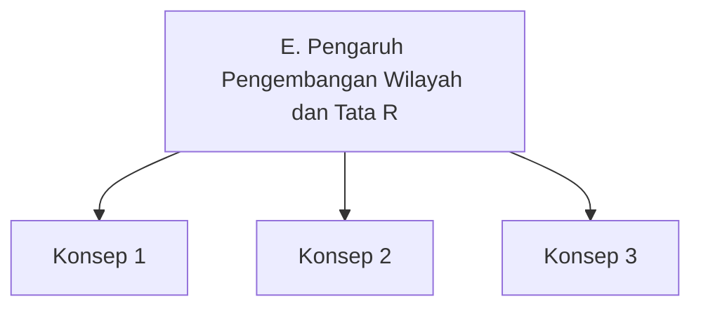

# E. Pengaruh Pengembangan Wilayah dan Tata Ruang terhadap Kebahagiaan Penduduk

!!! info "Tujuan Pembelajaran"
    Mengevaluasi pengaruh pengembangan wilayah dan tata ruang terhadap kebahagiaan penduduk.

## Peta Konsep

*(Ganti isi peta konsep di atas dengan konsep-konsep subbab ini.)*

## Materi Inti

*(Tulis materi di sini. Gunakan paragraf pendek, judul turunan, tabel, dan gambar yang ringan agar nyaman dibaca di HP.)*

### Subjudul 1

### Subjudul 2

## Contoh Kasus

!!! example "Studi kasus"
    *(Tuliskan contoh nyata di Indonesia, lengkap dengan data dan sumbernya, mis. BPS, Bappenas, atau Kementerian ATR/BPN.)*

## Rangkuman

- Poin 1
- Poin 2
- Poin 3

## Latihan

??? question "Soal 1"
    *(Tulis soal di sini.)*

    **Pilihan:** A. ... B. ... C. ... D. ...

    ??? success "Kunci dan pembahasan"
        *(Tulis kunci jawaban dan pembahasan.)*

??? question "Soal 2 (uraian/HOTS)"
    *(Tulis soal di sini.)*

    ??? success "Pedoman jawaban"
        *(Tulis pedoman jawaban.)*

## Referensi

- *(Cantumkan sumber: buku teks, laporan resmi, situs resmi, dengan tahun akses.)*
